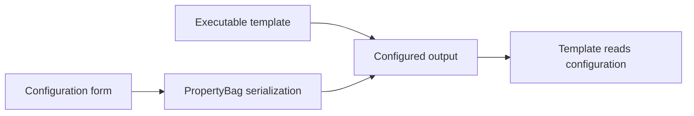

# EXE appender

**2000s · Visual Basic 6**

A configuration-builder experiment with two parts: a builder that attaches serialized values to an executable template, and a template that reads those values.

## Original project

- [Complete original files](originals/)
- [Builder project](originals/Compiler.vbp) and [form](originals/frmMain.frm)
- [Template project](originals/rdfce%20source/prjRdfce.vbp) and [form](originals/rdfce%20source/frmMain.frm)
- [Project group](originals/ExeDemo.vbg)

The original resources, template, generated executable, workspace files, comments, and metadata are kept together. No source has been rewritten.

## Design

*Diagram prepared in 2026 from the source.*

The builder uses binary file operations to add serialized configuration and position information. The template contains the corresponding reading logic and uses the configured values for an FTP operation.

The original project metadata names Softrix; those names and the existing comments are retained unchanged.

[Back to the collection](../README.md)
