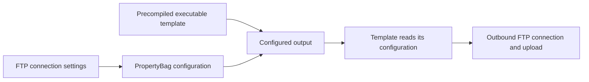

# EXE appender

**2000s · Visual Basic 6**

A server-configuration builder experiment with two parts: a builder that embeds FTP connection settings into a precompiled executable, and a template that reads those settings and uses them for an outbound FTP operation.

The focus is the mechanism used to configure Trojan server executables with new FTP settings. The unfinished VB6 project contains a closely related server-template builder. The [detailed analysis](analysis.md) explains the source, the relationship between the projects, and a read-only comparison of the archived binaries.

## Original project

- [Complete original files](originals/)
- [Builder project](originals/Compiler.vbp) and [form](originals/frmMain.frm)
- [Template project](originals/rdfce%20source/prjRdfce.vbp) and [form](originals/rdfce%20source/frmMain.frm)
- [Project group](originals/ExeDemo.vbg)

The original resources, template, generated executable, workspace files, comments, and metadata are kept together. No source has been rewritten.

## Design

*Diagram prepared in 2026 from the source.*

The builder stores the FTP host, username, and password as configuration. The template loads those values from its own executable file, connects to the configured FTP destination, and contains an upload of a fixed local image file. The compiled output is therefore intended to carry its own connection settings.

The networking role visible here is an FTP client. “Server” describes the generated agent's role. The available template does not contain the full functionality of a Trojan or the code that creates the image it attempts to upload.

The original project metadata names Softrix; those names and the existing comments are retained unchanged.

[Read the source and binary-layout analysis](analysis.md)

[Back to the collection](../README.md)
