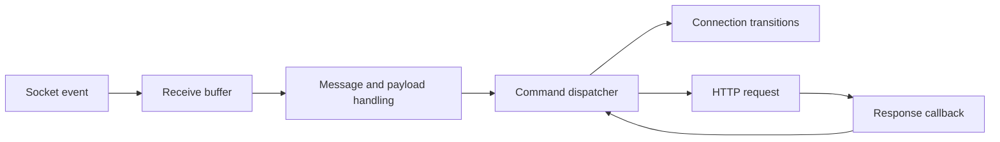

# MSN Hotmail Kira

**2000s · Visual Basic 6 · MSN protocol application**

The application resulting from my [MSN network investigation](../msn-network-investigation/README.md). I used that research to build an MSN socket conversation and an asynchronous HTTP sign-in flow. Its original interface describes freeze and defreeze actions.

## Intended outcome

The application put my account-lockout finding into practice. Repeated failed sign-ins caused Hotmail to block access, including access by the legitimate email-account owner. Keeping MSN Hotmail Kira running and continuing those attempts kept the owner unable to sign in to their email.

That is the historical meaning of the interface's “freeze” action. The research outcome was denial of account access through failed-sign-in lockout, and this application was the resulting implementation.

## Original project

- [Complete original files](originals/)
- [VB6 project](originals/hotmail%20kira.vbp)
- [Main form and protocol code](originals/hotmail%20kira.frm)
- [MD5 helper](originals/mdlMD5.bas)
- [Encryption helper](originals/modEncryption.bas)
- [About form](originals/about.frm)

Form resources, the compiled application, and the remaining original project files are preserved in the same folder.

## Application structure

*Diagram prepared in 2026 from the source.*

The source includes message framing, a transaction counter, command dispatch, redirect handling, and coordination between socket events, HTTP callbacks, timers, and UI actions.

The [network investigation](../msn-network-investigation/README.md) preserves the working notes and describes the discovery that led to this implementation. The two folders present successive stages of the same work: investigation followed by application development.

[Back to the collection](../README.md)
