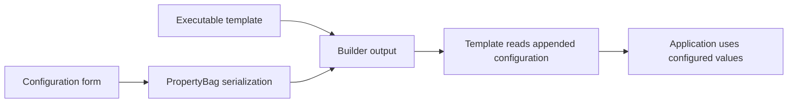

# Executable configuration builder

**Period:** historical VB6 archive; exact date unconfirmed.  
**Form:** architecture walkthrough reconstructed from source.  
**Status:** source inspected; original binaries were not run.

The surviving experiment separates an executable template from a builder that attaches configuration. It offers a compact example of moving information from a desktop form into a generated artifact, then reading it in the template application.

## Architecture

*Reconstructed in 2026 from the builder and template source.*

The builder writes form values to a VB6 `PropertyBag`, copies a template, and adds serialized data with a position value. The template source contains the corresponding binary-reading and property-loading logic. It then uses configured values in an FTP operation.

This description establishes the intended arrangement visible in source. It does not claim that all offsets, boundary conditions, or runtime behavior were verified. No executable configuration or credentials are distributed here.

## Engineering ideas worth preserving

- **Separate fixed behavior from variable data.** The template contains application behavior, while the builder supplies configuration.
- **Use a serialization boundary.** A property container transfers structured values between the two parts.
- **Define a reader as well as a writer.** The generated layout is meaningful because the template knows how to find and interpret it.

The source also raises questions about format validation, malformed input, and how errors should be reported. Those are retrospective review questions; this collection does not silently replace the historical implementation with a corrected modern one.

## Contribution and provenance

The archive associates this experiment with my early work. Tutorial-style comments survive, and the origin of every part has not been established. The presentation describes the mechanism and my experimentation without claiming that I invented the technique or wrote every dependency. See [credits](../../CREDITS.md).

[Return to the collection](../../README.md)
