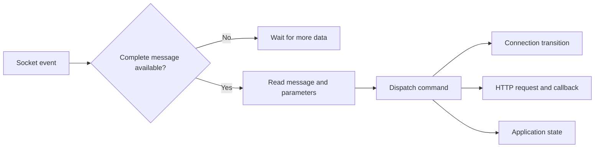

# MSN protocol application

**Period:** 2000s; exact date unconfirmed.  
**Form:** walkthrough of surviving VB6 source.  
**Status:** historical application; no current build or runtime validation.

The archived project is named `msn-hotmail-kira`. Its interface presents account-freezing behavior. This retrospective records that original purpose while focusing on the application structure that can be studied from the source.

The [attached original procedures](../../evidence/source/msn-application/message-framing.excerpt.vb) include the transaction counter, receive handler, and message reader. Original line ranges are marked; no procedure body has been fixed or modernized. The surrounding UI, authentication, and account-related operations are outside this excerpt.

## From received bytes to application actions

The receive handler looks for line boundaries. For selected message types, it also compares the available data with a declared payload length. A dispatcher handles protocol commands, while a separate HTTP object supplies asynchronous authentication responses. A transaction counter supplies request identifiers.

Those mechanisms are visible in source. Their presence does not establish correct handling of every possible incoming message or prove the interface's promised outcome.

## What deserves attention

The application coordinates multiple event sources: socket callbacks, HTTP completion, timers, and UI actions. It provides an early example of reasoning about application state across asynchronous operations. The related [network investigation](../../research/msn-network/README.md) supplies historical context.

The source also contains chat-related references whose corresponding implementation is not established in this project. Old IDE logs record missing controls, and helper-module provenance is partly unresolved. These limits are recorded rather than hidden behind a current demonstration.

Authentication values, server request captures, executables, and account-disruption functionality are not republished. See [evidence](../../EVIDENCE.md) and [credits](../../CREDITS.md) for the scope of the retrospective.

[Return to the collection](../../README.md)
