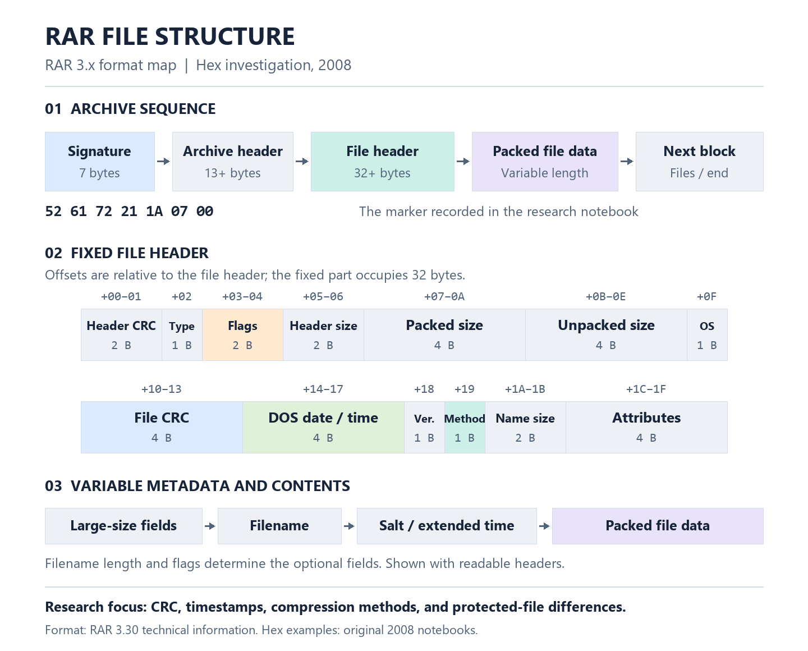
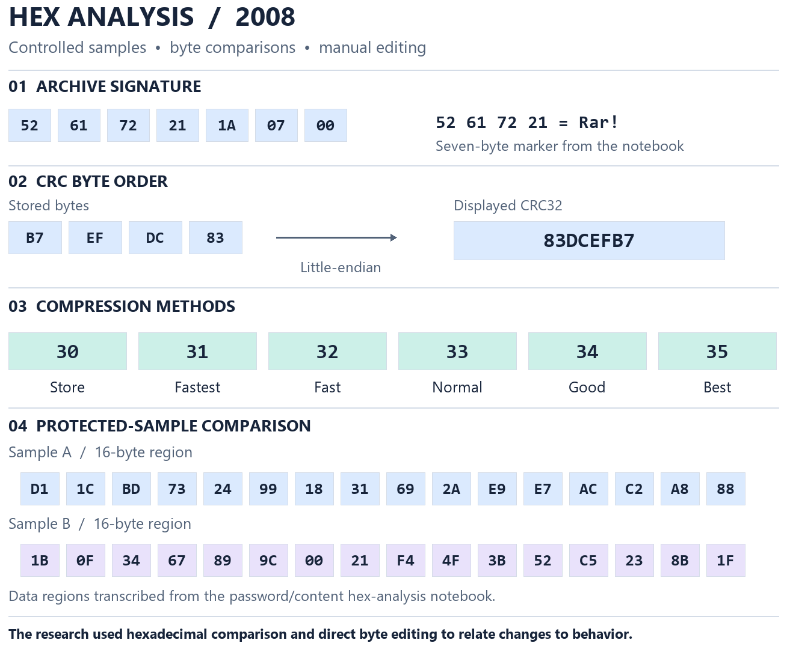
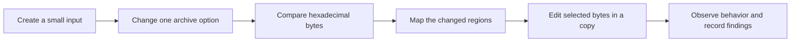

# RAR format investigation through hex analysis

**2008 · Binary format research**

A byte-level investigation of RAR archive structure, metadata, compression, and password handling. Controlled sample creation, hexadecimal comparisons, and manual byte editing connected changes in the archive to changes in application behavior. Three notebooks document the experiments and conclusions.

## Structure and findings map

[Open the structure map as SVG](assets/rar-structure.svg)

The map connects the investigated regions to the archive structure: signature, CRC, timestamps, compression method, filenames, and file contents. Field offsets are relative to the file header. Format reference: [RAR 3.30 technical information](https://sources.debian.org/src/rar/3.30-2/technote.txt/).

## Hex comparisons

[Open the hex comparison as SVG](assets/hex-comparisons.svg)

The signature, CRC example, and two 16-byte regions come from the original notebooks. The comparison highlights the research method: inspect hexadecimal values, vary one condition, edit selected bytes, and observe the result. Compression-method values connect the notebook's setting comparisons to the format map.

## Findings and conclusions from 2008

The table summarizes the findings and conclusions documented in the 2008 notebooks.

| Area | Conclusion in the 2008 notebooks |
|---|---|
| Archive structure | The opening signature and metadata regions were mapped to the filename, file size, timestamps, CRC, and compression method. |
| CRC and contents | Identical contents produced identical CRC values. The byte ordering was related to the CRC displayed by the application. |
| Compression | Changes in the method bytes were mapped to storage and the different compression settings. |
| Timestamps | Date and time regions were identified, including the two-second relationship for seconds. |
| Protected archive size | One comparison measured a 23-byte size difference between protected and unprotected samples. |
| Password representation | The early format model assigned a “16 hex” region to the password and an “8 hex” region to content. |
| Replacing archive regions | Region replacements between samples with matching contents or CRCs were recorded as changing the accepted password. The notebooks also document failed replacements and incorrect-password errors. |
| Header changes and repair | Header changes and repair were recorded as removing protection from an edited sample, with some modifications accepting different passwords. |
| Password length | The recorded result was that only the first 127 characters of a long test password affected the outcome in the tested version. |

The [final notebook entry](originals/WinRAR_Reverse_Engineering_Notes_2008.txt#L631) records “F1” working after a failed replacement. The original wording remains unchanged.

## Original files

- [Main reverse-engineering notebook](originals/WinRAR_Reverse_Engineering_Notes_2008.txt)
- [Empty-archive header comparison](originals/WinRAR_Empty_RAR_Header_Comparison_2008.txt)
- [Password and content hex analysis](originals/WinRAR_Password_Content_HEX_Analysis_2008.txt)

All three files are complete, unredacted copies of the archived originals, including their original encoding and line endings.

## Approach

*Diagram prepared in 2026 from the original notes.*

The experiments include creating files of known sizes, comparing protected and unprotected archives, varying compression, and changing individual byte regions. The notebooks also record how different changes affected errors and archive behavior.

The figures are generated by the [diagram renderer](assets/render-diagrams.py). It checks the transcribed signature, CRC bytes, and sample regions against the original notebooks before rendering.

[Back to the collection](../README.md)
