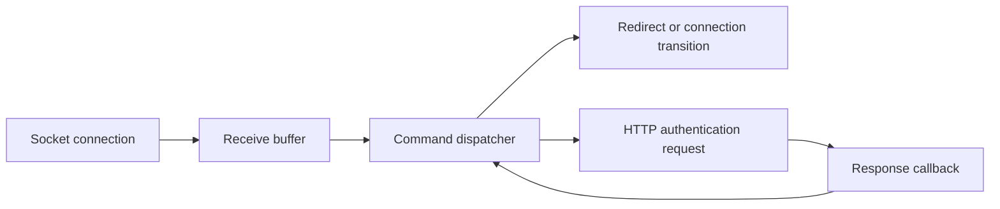

# Investigating MSN connections

**Period:** 2000s; the notebook filename labels it 2006, but the exact chronology is uncertain.  
**Form:** investigation diary reconstructed from notes and related source.  
**Evidence:** one network notebook and a VB6 protocol application.

I explored how an MSN client connected, moved between servers, and interacted with its sign-in service. The notes mix connection observations, possible explanations, request experiments, and reminders for later tests.

Inspect the [actual notebook with redactions](../../evidence/notes/msn/network-research.redacted.txt) and the [original message-framing procedures](../../evidence/source/msn-application/message-framing.excerpt.vb). The notebook retains its line order; explicit markers replace sensitive captures. The source excerpts retain original procedure bodies without implementation edits.

## A sequence of questions

| Question | What survives | What it supports |
|---|---|---|
| Does one connection handle every stage? | Records of connections opening and closing, different destinations, and different port use. | I was trying to distinguish roles and stages instead of treating the application as one opaque connection. |
| What happens when a destination is blocked or a connection ends? | Notes linking changes in connectivity to client behavior. | Behavioral experiments aimed at testing dependency hypotheses. |
| How does authentication relate to the socket conversation? | Request and redirect experiments, alongside callback-driven HTTP handling in the application. | Investigation of a flow involving more than one protocol or component. |
| How should received data be interpreted? | The application checks for complete lines and, for some commands, a declared payload length. | Awareness that a received chunk is not automatically one complete application message. |

## Reconstructed application flow

*An explanation of the surviving source structure, not a fresh observation of the historical service.*

## What I learned to investigate

The notebook's useful thread is the connection between an observation and a hypothesis: a new destination might have a different role; a blocked connection might reveal a dependency; a server response might require a state transition rather than an immediate final result.

The related code uses socket events, a command dispatcher, transaction IDs, and HTTP completion callbacks. These mechanisms provide a more concrete companion to the informal notes. See the [application walkthrough](../../projects/msn-application/README.md).

## Limits of the reconstruction

The notes do not form a complete protocol specification. Some explanations are tentative, and the available material does not prove every server-role assignment. No historical service was contacted for this retrospective.

Authentication strings, email addresses, passwords, private details, and captured request URLs are omitted. The [selected observations](selected-observations.md) preserve the reasoning without reproducing those values.

[Return to the collection](../../README.md)
